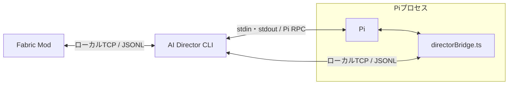
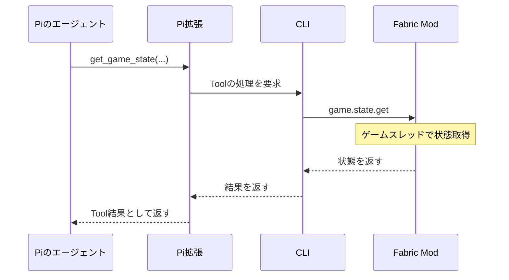

# AI Director Mod 設計

2026-10-16時点の構想と実装に向けた設計案。CLI本体とFabric Modは未実装である。

## 目的と基本方針

プレイヤーの状態や行動を理解したAIが、長期目標と次の行動を決め、ゲーム内チャットを通じて自発的に指示・提案する。
目的は効率的な攻略だけではなく、プレイヤーが普段なら選ばない遊び方を生み出すことである。

AIは相談にも答える。例えば、作りたいものの必要資材を調べて不足数を計算する一方、現在の方針に合わなければ寄り道を断ることもある。
ゲーム操作の代行は初期の対象に含めず、プレイヤーへの働きかけはチャットで行う。

合意した方針は次の通り。

- シングルプレイを優先する。
- 本体は常駐CLIとし、Fabric Modはゲーム接続インターフェイスにする。
- PiはPATH上の`pi`を子プロセスとして利用する。
- 推論、会話、Tool呼び出しの実行基盤はPiに任せる。
- 平時は開始時の指示と定期ポーリングで判断する。
- 必要な応答hookは、LLM自身がToolで追加・削除する。
- 個数や進捗、次の行動の判断はLLMに任せ、CLIやModに目標別の進行ロジックを実装しない。
- ゲーム生データへのアクセスを許し、ネタバレの扱いは主にLLMへの指示で制御する。

以下の通信方式、プロトコル、Tool名は具体設計案であり、実装による検証はまだ行っていない。

## 構成と責務

CLIはTypeScript / Node.js、ModはJava / Fabricを想定する。
Pi拡張の`directorBridge.ts`はCLI側に同梱し、Piから明示的に読み込む。



| 要素 | 責務 |
| --- | --- |
| Fabric Mod | 状態取得、イベント検出、チャット入力通知、AI発言の表示、レシピ・生データの取得 |
| CLI | 接続管理、観測記憶・イベント履歴の保存、ポーリング、hook登録・照合、Piの起動と実行調整 |
| Pi | 会話と目標の保持、推論、Toolの選択・呼び出し |
| Pi拡張 | ゲーム用Toolの登録、CLIへの要求と結果の受け渡し、最新コンテキストの注入 |

ワールドに入ったときに対応するPiセッションを開始・再開し、退出時に終了する。
CLI自体はゲーム未接続でも待機できる。
会話、観測記憶、hookはワールドとプレイヤーを識別して管理する。

Piの通常のコーディング用Toolや無関係な拡張・コンテキストの自動読み込みを無効にし、専用のシステムプロンプトとゲーム用Toolを使う。
ゲーム情報へのアクセス方針と、OS上のファイル・コマンドへアクセスするToolの設定は分けて扱う。

## コンテキストと記憶

### 毎回渡すコンテキスト

LLMの各呼び出し前に、Pi拡張の`context`イベントから最新情報を取得して注入する。
Tool実行後の再判断も対象とし、過去のスナップショットを毎回会話履歴へ積み続けない。

- 位置、ディメンション、バイオーム、周辺情報。
- ゲーム内時刻。
- 体力。
- インベントリ。
- 最近のAIの発言。
- 起動理由。プレイヤーの入力、定期ポーリング、発火したhookとイベント内容。

現在の目標・方針はPiの会話と合わせて参照する。
位置は座標だけでなく、周辺の地形、ブロック、エンティティなど判断に必要な情報を含める。
状態には取得時点のtickや時刻を付け、現在値と過去の観測を区別する。

### Toolで参照する観測記憶

Modが観測した情報をCLIへ送り、CLI側で保存・検索する。

| 種類 | 内容 |
| --- | --- |
| 発見履歴 | 発見した構造物・Mob・バイオーム、位置、確認時刻 |
| チェスト履歴 | 開けたチェストの位置、中身、最終確認時刻 |
| 死亡履歴 | 死亡した位置、ディメンション、時刻 |

チェスト履歴は最終確認時点の中身として扱い、現在も同じ内容であると断定しない。
何を「発見済み」と記録するか、どの操作でチェストの記録を更新するかは対象Minecraftバージョンで具体化する。

### 生データとネタバレ

必要に応じて、ゲーム状態、レシピ、Mod環境などの生データをToolで取得できるようにする。
厳格な情報アクセス制限は設けず、次の方針をLLMへ指示する。

- AIが知っていても、プレイヤーがまだ知り得ないワールド固有の情報は明かさない。
- 未発見の鉱石・構造物などの位置を直接教えたり、その情報を使って露骨に誘導したりしない。
- 発見済みの情報は記憶を検索して案内できる。
- レシピや必要資材などの一般知識は相談に利用する。

これは指示による制御であり、ネタバレを完全に防ぐ技術的な保証ではない。

## 通信方式

| 接続 | 方式 | 用途 |
| --- | --- | --- |
| CLI ↔ Fabric Mod | ローカルTCP、UTF-8のJSONL、JSON-RPC 2.0 | イベント通知、状態取得、発言表示 |
| CLI ↔ Pi | stdin / stdout、Pi標準RPC | 判断開始、中断、状態・完了の確認 |
| CLI ↔ Pi拡張 | Modと同じTCPサーバーへの別接続 | Tool要求・結果、コンテキスト取得 |

Node.jsの`node:net`とJavaの`Socket`で双方向通信を実装できるため、初期案はTCPとする。
Piの標準RPCと、独自のJSON-RPC 2.0は別のプロトコルであり、形式を混同しない。

### 接続手順

1. ユーザーが`ai-director`を起動する。
2. CLIが`127.0.0.1`の空きポートで待ち受ける。
3. 接続先、起動ごとのトークン、プロトコルバージョンを、ユーザー専用の接続情報ファイルへ保存する。
4. Modが接続情報を読み、CLIへ接続する。
5. `bridge.hello`でトークン、役割、プロトコルバージョンを確認する。
6. ワールド入場時、Modがワールド・プレイヤー情報と対応イベント一覧を通知する。
7. CLIがPATH上のPiを起動する。接続先とトークンは子プロセスの環境変数でPi拡張へ渡す。
8. Pi拡張がCLIへ接続し、準備が整ったら最初の判断を開始する。

接続情報ファイルの配置場所は実装時に確定する。
秘密情報を含むため所有ユーザーだけが読める権限にし、トークンをログへ出さない。
初版は1つのゲーム接続を扱う。

`worldId`は保存されたワールドを、`worldSessionId`は今回の接続・入場を識別する。
再接続・再入場時には新しい`worldSessionId`を割り当てる。
実行開始時の識別子をTool要求にも引き継ぎ、CLIは現在の接続と一致することを確認する。
古い実行の要求を、新しく接続したワールド向けに付け替えない。

### メッセージ形式

- 1行につき1つのJSONオブジェクトを送り、LFで区切る。
- `id`付きの要求には、同じ`id`で結果またはエラーを返す。
- イベントなど、応答が不要な通知には`id`を付けない。
- TCPの受信単位とJSONの境界は一致しないため、LFまでバイト列を蓄積して解析する。
- Piのstdoutは標準RPC専用とし、診断ログはstderrへ分ける。
- 送受信のバックプレッシャーを扱う。フレームサイズと要求時間にも上限を設け、具体値は検証時に決める。

CLIからModへの要求例。

```json
{"jsonrpc":"2.0","id":"game-19","method":"game.state.get","params":{"worldSessionId":"w1","query":{"inventory":true}}}
```

Modからの応答例。

```json
{"jsonrpc":"2.0","id":"game-19","result":{"worldSessionId":"w1","tick":12040,"inventory":[{"itemId":"minecraft:cobblestone","count":7}]}}
```

Modからのイベント通知例。

```json
{"jsonrpc":"2.0","method":"game.event","params":{"worldSessionId":"w1","seq":85,"tick":12042,"event":"block_broken","data":{"blockId":"minecraft:stone","position":[10,64,20]}}}
```

`seq`は`worldSessionId`内で増加するイベント番号とし、順序や欠損の確認に使う。

### 主な通信メソッド

| メソッド案 | 要求・通知の方向 | 処理 |
| --- | --- | --- |
| `bridge.hello` | Mod / Pi拡張 → CLI | 接続の初期確認 |
| `game.attach` | Mod → CLI | ワールド・プレイヤー・対応イベントの登録 |
| `game.status` | Mod → CLI | プレイ中・ポーズ中などの状態通知 |
| `game.detach` | Mod → CLI | ワールド退出通知 |
| `game.event` | Mod → CLI | ゲーム内イベントの通知 |
| `game.player_message` | Mod → CLI | プレイヤーからAIへのチャット入力 |
| `game.state.get` | Pi拡張 → CLI → Mod | ゲーム状態の取得 |
| `game.recipes.get` | Pi拡張 → CLI → Mod | レシピの取得 |
| `game.message.send` | Pi拡張 → CLI → Mod | AIの発言表示 |
| `director.context.get` | Pi拡張 → CLI | 最新状態と起動理由などの取得 |
| `director.hooks.add` / `remove` / `list` | Pi拡張 → CLI | hookの管理 |
| `director.events.get` | Pi拡張 → CLI | イベント履歴の取得 |
| `director.memory.search` | Pi拡張 → CLI | 観測記憶の検索 |

## Tool一覧と呼び出し

LLMへ公開するToolはPi拡張で登録する。
CLIがPiのTool実行イベントを見て後から結果を注入する方式にはせず、拡張の`execute()`が実処理を待ち、その結果をPiへ返す。

| Tool案 | 引数の概要 | 実処理 |
| --- | --- | --- |
| `send_message` | `text` | Modへ表示を要求し、表示完了を待つ |
| `add_response_hook` | `event`, `filter?`, `instruction` | CLIで登録・保存し、hook IDを返す |
| `remove_response_hook` | `id` | CLIで削除 |
| `list_response_hooks` | なし | CLIの登録内容を返す |
| `get_recent_events` | `since?`, `limit?` | CLIのイベント履歴を検索 |
| `get_game_state` | `query` | Modから必要な生データを取得 |
| `get_recipes` | `item` | Modからレシピを取得 |
| `search_memory` | `type`, `query` | CLIの観測記憶を検索 |

`get_game_state`の対象には、所持数、周辺、ブロック、エンティティ、Mod環境などを想定する。
最初に公開するqueryの形式は、対象バージョンで取得できるデータを調べて確定する。
必要資材の計算と、現在の所持数との比較はLLMが行う。

`send_message`を呼んだ場合にだけプレイヤーへ発言を表示する。
内部で状態確認やhook変更をしただけなら、無言で終了できる。
ワールド識別などの接続情報はLLMの引数に要求せず、実行に結び付けた値を通信層が付ける。



要求IDは接続ごとに管理し、CLIはPi拡張からの要求とModへ転送した要求の対応を保持する。
hook管理や記憶検索ではModへの転送は発生しない。
Piの完了を待っている間もCLIは通信を処理し、Toolからの要求を受け付ける。

Modは通信スレッドからゲームオブジェクトを直接操作しない。
状態取得はサーバースレッド、チャット表示はクライアントスレッドへ処理を渡し、通信でゲーム進行をブロックしない。

## ポーリングと応答hook

### AIを起動する入口

1. ワールド開始時の最初の判断。
2. プレイヤーからのチャット。
3. 定期ポーリング。
4. LLMが登録したhookの発火。

通常のゲームイベントはCLIへ通知・記録するが、記録するだけではLLMを起動しない。
ポーリングや登録済みhookなど、起動理由がある場合に判断を依頼する。

### 定期ポーリング

```text
接続中・プレイ中であることを確認
  → CLIの定期タイマーが発火
  → 判断を予約
  → Piが空いたらmedium以上で実行
  → 必要ならToolで確認
  → 発言・hook変更・無言で終了
```

初期検証ではプレイ中60秒程度を仮置きする。計測済みの最適値ではない。
CLIがプレイ中の経過時間を管理し、ポーズ中・切断中は新しい定期判断を止める。
定期判断の予約は1件にまとめ、復帰後に過去の回数分を実行しない。

### 応答hook

hookは、指定イベントが起きたときにAIへ判断を依頼する予約である。
Pi自体のライフサイクルイベントとは区別する。

LLMによる登録例。

```json
{
  "event": "block_broken",
  "filter": {"blockId": "minecraft:stone"},
  "instruction": "かまど作成の進捗を確認し、次の行動を判断する"
}
```

`filter`はイベントに含まれるIDなど、監視対象を指定するためのものとする。
CLIはイベントと対象の一致を判定し、所持数や進捗の意味は解釈しない。
LLMは対応イベント一覧を参照し、必要なhookをToolで設定する。

```text
Modがイベントを通知
  → CLIが記録
  → 登録済みhookと照合
  → 一致したhookの指示とイベントを添えて判断を予約
  → PiがコンテキストやToolで状態を確認
  → 発言・hook変更・無言で終了
```

hookはLLMが削除するまで維持する。
登録後にCLIが受け取ったイベントを対象とし、過去の出来事はイベント履歴から確認する。
目標変更時に不要になったhookを削除する判断もLLMに任せる。

### かまど作成の例

| 起動理由 | LLMの動作 |
| --- | --- |
| 開始時 | 「かまどを作りましょう」と発言し、石破壊hookを追加 |
| 定期ポーリング | 木を切り続けていれば「先に丸石を集めてください」と発言 |
| 石破壊hook | 所持数を確認し、足りなければ無言で終了 |
| 石破壊hook | 十分なら「クラフトしましょう」と発言。石破壊hookを削除し、かまど入手hookを追加 |
| かまど入手hook | 次の行動を判断し、必要なhookへ変更 |

この進行を専用の状態機械として実装しない。
石の破壊と丸石の入手のタイミングの違いなども、最新状態と履歴を取得してLLMが判断する。

### Pi実行中の扱い

Piは基本的に1実行ずつ処理する。
CLIが実行待ちを管理し、同じhookの発火はイベントを失わずにまとめて次回へ渡す。
プレイヤーからの入力も保持し、定期判断を重ねて予約しない。

即応を優先して割り込む場合は、現在の処理を中断し、停止を確認してから次を開始する。
即応と通常処理の具体的な優先順位は、初期検証で確定する。

Piの`steer`は進行中のAPI応答を即座に中断する機能ではなく、次のLLM呼び出し前に入力を渡す仕組みである。
実行の完了確認には`agent_settled`を使う。
`prompt`の受理応答や`agent_end`だけでは、その後の自動処理まで完了したと判断しない。

### 推論設定

| 用途 | 初期案 |
| --- | --- |
| 定期的な進行判断 | `medium`以上 |
| 短い即応判断 | `quick`というアプリ側の呼び名で、利用可能な低推論設定へ対応付ける |
| 詳しい再検討 | 必要に応じて`high`で続ける |

Piの推論設定に`instant`はない。
`quick`の具体的な設定は選択モデルの対応状況を確認し、未対応の設定へ黙ってフォールバックしない。
モデル・推論設定の変更は実行停止後に行う。
即応後の詳しい判断は毎回必須にせず、必要な場合に予約する。
低推論設定でも応答時間は保証されない。

## 切断・失敗時の扱い

- Mod切断時は、実行待ちのゲーム要求を失敗させ、ポーリングとhookによる新しい起動を止める。
- 実行中の判断も停止させ、古いワールド向けのTool処理を受け付けない。
- Toolのタイムアウト、データ取得失敗、未対応の要求はエラーとしてPiへ返す。空データで成功扱いにしない。
- 必須コンテキストを取得できない場合、その判断を止める。
- 発言表示など、処理済みか不明な要求を自動再送しない。
- 再接続時は最新状態を取得し、イベント欠損があれば明示する。古いhook発火をまとめて再実行しない。
- 同じワールドでは既存hookと記憶を参照できるようにし、再開時にLLMが状況を確認する。
- PATH上のPiを起動できない場合は、起動エラーとして表示する。

## 検証済み事項と未確定事項

### 検証済み事項

本設計の検討時、ローカルのPATH上にあるPi 1.2.0で、LLMを呼び出さずに次を確認した。

- RPCモードでの起動。
- `get_state`による状態取得。
- `get_available_thinking_levels`による対応設定の取得。
- stdinを閉じての正常終了。

この確認はCLIとModの接続、Toolの往復、実モデルの応答速度を検証したものではない。

### 実装前・初期検証で確定する事項

- Minecraft、Fabric Loader、Fabric APIの対象バージョン。
- アイテム破棄・入手、コンテナ閲覧などの取得方法と必要なMixin。
- 発見済み情報の記録基準と、レシピ・Mod環境の取得範囲。
- `get_game_state`のquery形式、イベントのデータ形式、対応するfilter。
- データ保存先、接続情報ファイルの配置、ワールドIDの保存方法。
- ポーリング間隔、即応時の優先順位、推論設定、要求タイムアウトとフレームサイズ。
- Minecraftランチャーから起動した環境でもPiをPATHから見つけられるか。

### 初期実装の確認シナリオ

1. Mod接続後、プレイヤーの入力がPiへ渡り、`send_message`による返答がゲーム内に表示される。
2. `get_game_state`が実際の所持数を返す。
3. 定期ポーリングで判断が起動し、ポーズ・切断中は新しい定期判断が起きない。
4. LLMがhookを登録し、対応イベントで起動し、Toolで削除できる。
5. Pi実行中に届いたイベントを、次の判断へ渡せる。
6. ワールド退出後、古い実行からの発言が新しいワールドへ届かない。
7. 切断・タイムアウトが明示的な失敗になり、発言が勝手に再送されない。

初版の対象はローカルの1ゲーム接続とする。
遠隔接続、複数ゲーム対応、ModからのCLI自動起動、ゲーム操作の代行は含めない。

## 一次資料

- [Pi RPC仕様](https://github.com/earendil-works/pi/blob/main/packages/coding-agent/docs/rpc.md)
- [Pi RPCコマンド](https://github.com/earendil-works/pi/blob/main/packages/coding-agent/docs/rpc-commands.md)
- [Pi拡張仕様](https://github.com/earendil-works/pi/blob/main/packages/coding-agent/docs/extensions.md)
- [Pi CLI仕様](https://github.com/earendil-works/pi/blob/main/packages/coding-agent/docs/cli.md)
- [JSON-RPC 2.0仕様](https://www.jsonrpc.org/specification)
- [Node.js TCP API](https://nodejs.org/api/net.html)
- [Java Socket API](https://docs.oracle.com/en/java/javase/21/docs/api/java.base/java/net/Socket.html)
- [Fabricイベント](https://docs.fabricmc.net/develop/events/)
- [Fabricのクライアント・サーバー構成](https://docs.fabricmc.net/develop/networking)
