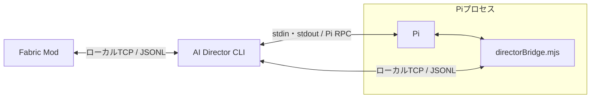

# 構成と責務

以下は実装済みの構成。[起動手順と実装状況](<development.md>)を参照。
CLIは単一のTypeScript / Node.jsパッケージ、Modは独立したJava / Fabricプロジェクトとする。
Pi拡張はCLI側でESMの`directorBridge.mjs`へビルドして同梱し、Piから明示的に読み込む。

| 要素 | 責務 |
| --- | --- |
| Fabric Mod | 状態取得、広いイベント観測、チャット入力通知、AI発言のローカル表示 |
| CLI | 接続管理、イベント履歴の保存・検索、ポーリング、hook登録・照合、Piの起動と実行調整 |
| Pi | 会話と目標の保持、推論、Toolの選択・呼び出し |
| Pi拡張 | ゲーム用Toolの登録、CLIへの要求と結果の受け渡し、最新コンテキストの注入 |

ready済みのワールドに対応するPi子プロセスを開始し、退出時に終了する。
会話の保存scopeはworld / playerであり、再接続で変わるworldSessionIdとは独立する。
CLI自体はゲーム未接続でも待機できる。
会話、イベント履歴、hookはワールドとプレイヤーを識別して管理する。
イベント追加では定義とModのobserver・テストを追加し、保存・検索・hook照合の共通処理は変更しない。
観測ログの収集はhookやLLM呼出しから独立させ、判断のまとめ処理で元イベントを捨てない。

Piの通常のコーディング用Toolや無関係な拡張・コンテキストの自動読み込みを無効にし、専用のシステムプロンプトとゲーム用Toolを使う。
許可するのは[10 Tool](<tools.md>)だけ。組込Bash・OSファイル・書込・任意ネットワーク・操作代行Toolは公開しない。
静的参照はゲーム側の公開loader rootに限定する。Piプロセス自体のOS / network sandboxではない。

## 一次資料

- [Pi CLI仕様](https://github.com/earendil-works/pi/blob/main/packages/coding-agent/docs/cli.md)
- [Pi RPC仕様](https://github.com/earendil-works/pi/blob/main/packages/coding-agent/docs/rpc.md)
- [Pi拡張仕様](https://github.com/earendil-works/pi/blob/main/packages/coding-agent/docs/extensions.md)

## 関連資料

- [用語と命名](naming.md)
- [コンセプトと基本方針](concept.md)
- [通信プロトコル](protocol.md)
- [Tool一覧と呼び出し](tools.md)
