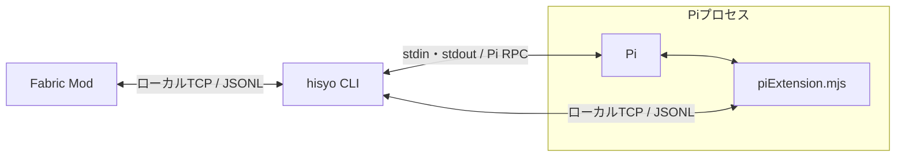

# 構成と責務

以下は実装済みの構成。[起動手順と実装状況](<development.md>)を参照。
CLIは単一のTypeScript / Node.jsパッケージ、Modは独立したJava / Fabricプロジェクトとする。
Pi拡張はCLI側でESMの`piExtension.mjs`へビルドして同梱し、Piから明示的に読み込む。

| 要素 | 責務 |
| --- | --- |
| Fabric Mod | game stateの取得、イベント観測、チャット入力通知、hisyoの発言のローカル表示 |
| CLI | session管理、event log・activity log・hook・summaryの保存、runの予約と調整、Piの起動 |
| Pi | conversationの保持、hisyoとしての推論、Toolの選択・呼び出し |
| Pi拡張 | ゲーム用Toolの登録、CLIへの要求と結果の受け渡し、最新game stateとsummaryの注入 |

ready済みのsessionに対応するPi子プロセスを開始し、退出時に終了する。
conversationの保存scopeはworld / playerであり、再接続で変わる`sessionId`とは独立する。
CLI自体はゲーム未接続でも待機できる。
conversation、event log、activity log、summary、hookはワールドとプレイヤーを識別して管理する。
event logはMod由来の観測、activity logはCLIが確認した入力・表示・hook変更・run要求などの事実を保存する。
イベント追加では定義とModの観測処理・テストを追加し、保存・検索・hook照合の共通処理は変更しない。
event logの収集はhookやrunから独立させ、run requestの集約でも元の観測を捨てない。

summaryはevent logだけから派生する。CLIと同じプロセス内の独立したschedulerが作成を予約し、Pi拡張がToolなしのモデル呼出しを行う。
runとは時計・single-flight・取消を分け、pause中もsummaryの新規開始・完了・保存を続ける。
ChatGPT OAuthは各summaryの前に信頼済みPi所有者が更新し、隔離子にはaccess tokenだけを渡す。

Piの通常のコーディング用Toolや無関係な拡張・コンテキストの自動読み込みを無効にし、専用のシステムプロンプトとゲーム用Toolを使う。
許可するのは[10 Tool](<tools.md>)だけ。組込Bash・OSファイル・書込・任意ネットワーク・操作代行Toolは公開しない。
referenceはゲーム側の公開loader rootにある静的packageファイルに限定する。Piプロセス自体のOS / network sandboxではない。

## CLIのフォルダ単位

- [events](<../src/events/>)は[EventCatalog](<../src/events/eventCatalog.ts>)と[activity定義](<../src/events/activity.ts>)、
  [summaryInput](<../src/events/summaryInput.ts>)の入力加工を持ち、SQLを扱わない。
- [storage](<../src/storage/>)はDB初期化と、[EventLog](<../src/storage/eventLog.ts>)・[ActivityLog](<../src/storage/activityLog.ts>)・
  [HookStore](<../src/storage/hookStore.ts>)の保存、[searchLog](<../src/storage/logSearch.ts>)の共通検索、[summaryStore](<../src/storage/summaryStore.ts>)をまとめる。

データの種類だけで分けず、意味の定義・入力加工とSQL永続化の責務をフォルダ単位で分離する。永続化のテストも対象実装の隣へ置く。

## 一次資料

- [Pi CLI仕様](<https://github.com/earendil-works/pi/blob/main/packages/coding-agent/docs/cli.md>)
- [Pi RPC仕様](<https://github.com/earendil-works/pi/blob/main/packages/coding-agent/docs/rpc.md>)
- [Pi拡張仕様](<https://github.com/earendil-works/pi/blob/main/packages/coding-agent/docs/extensions.md>)

## 関連資料

- [用語と命名](<naming.md>)
- [コンセプトと基本方針](<concept.md>)
- [通信プロトコル](<protocol.md>)
- [Tool一覧と呼び出し](<tools.md>)
