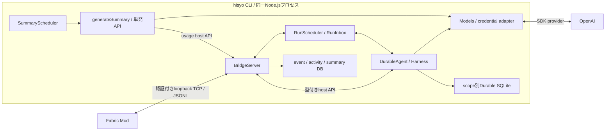

# 構成と責務

CLIは単一のTypeScript / Node.jsパッケージ、Modは独立したJava / Fabricプロジェクトとする。
推論とconversationの実行基盤は、CLIと同じプロセスで動くPi Durable SDKである。
依存する`@earendil-works/pi-durable`、`@earendil-works/pi-ai`、`@earendil-works/chord`はすべてreleased 1.3.0へ固定する。
[起動手順と検証範囲](<development.md>)を参照。

## 所有者と境界

| 要素 | 責務 |
| --- | --- |
| Fabric Mod | game state取得、観測、入力通知、hisyoの発言のローカル表示、ゲームスレッドでのbinding検証 |
| [hisyoRuntime](<../src/runtime/hisyoRuntime.ts>) | 設定・認証・bridge・scheduler・timerの構成と終了順序 |
| [RunScheduler](<../src/runtime/runScheduler.ts>) | pauseによる新規runの制限、単一実行、ゲーム接続の寿命、入力受付 |
| [RunInbox](<../src/runtime/runInbox.ts>) | 集約済みの保留理由とdispatch予約をconversation内のdocumentへ保存 |
| [DurableAgent](<../src/runtime/durableAgent.ts>) | mainのHarness、conversation、10 game Toolとlocal `update_plan`、毎要求のcontext、モデル呼出し、取消とclose |
| [longTermPlan](<../src/runtime/longTermPlan.ts>) | 長期方針のtyped document、strict schema・byte上限、revision付き全置換、SDK-localな`update_plan` |
| [SummaryScheduler](<../src/runtime/summaryScheduler.ts>) / [generateSummary](<../src/runtime/generateSummary.ts>) | 最新の終了済み1分を優先する連続処理、single-flight・取消・保存と、履歴・Tool・session保存を持たない単発API要求 |
| [trackModelRequest](<../src/runtime/trackModelRequest.ts>) | runとsummaryで共有するusage計測・記録と、provider完了までの要求所有権 |
| [BridgeServer](<../src/bridge/bridgeServer.ts>) | game TCP認証、session / run binding、game Toolの実処理、domain記録と結果検証 |
| [modelAccess](<../src/runtime/modelAccess.ts>) | native OpenAI providerと固定モデル、選択した認証源だけを使うModels |
| [PiCredentialStore](<../src/runtime/piCredentialStore.ts>) | 元の認証保存先を共有lockで読む・更新するSDK CredentialStore adapter |

Modとのwireは[protocol version 2](<protocol.md>)。TCPで受け付ける役割は`game`だけである。
Durableからのgame Tool、summary context、usage記録は信頼済みのin-process APIを使い、追加のagent socketは開かない。
SDKのregistryへ登録するのは専用prompt、[10 game Toolとlocal `update_plan`](<tools.md>)。mainモデルのTool surfaceは計11個で、bridgeが受け付けるgame Toolは従来の10個のままである。
コーディングTool、shell、一般OSファイル、任意ネットワーク、ゲーム操作代行はモデルへ公開しない。
これはToolの権限境界であり、Node.jsプロセスのOS / network sandboxではない。

モデルはnative catalogの`openai/gpt-6-luna`、主処理は`medium`固定とする。
独立summaryは同じモデルへToolなし、`reasoningEffort: low`、`serviceTier: priority`で要求する。
主処理とsummaryはsingle-flight・取消を別に管理する。summaryは終了済みUnix分を最新優先で連続処理し、pause中も進める。
モデルやtierの自動fallbackは行わない。

## 永続化の分担

world / playerが保存scopeで、再接続ごとに変わる`sessionId`とは独立する。
CLIはゲーム未接続でも待機できるが、主処理のモデル要求とTool効果には現在のready済みsessionとnative run bindingが必要である。
独立summaryは現在のready済みSessionBindingだけを要求し、native runのslot・bindingを取得しない。

| 保存対象 | 場所と所有者 |
| --- | --- |
| Modの観測 | `eventLog.sqlite`。 [EventLog](<../src/storage/eventLog.ts>) |
| CLI事実とhook | `activityLog.sqlite`。 [ActivityLog](<../src/storage/activityLog.ts>) / [HookStore](<../src/storage/hookStore.ts>) |
| 観測のsummaryと要約済みID | `summary.sqlite`。 [SummaryStore](<../src/storage/summaryStore.ts>) |
| conversation、実行task、run inbox、長期方針 | `durable/<scope hash>/conversation.sqlite`。 [durableStorage](<../src/runtime/durableStorage.ts>)とHarness |

scope hashは`JSON.stringify([worldId, playerId])`のSHA-256。
DurableのSQLiteは新しい保存形式・場所であり、既存のPi conversation JSONLを読み込まず、変換・削除もしない。

[events](<../src/events/>)はイベントの意味・schema・summary入力加工を、[storage](<../src/storage/>)はdomain SQL永続化を持つ。
Durableのtask保存をevent logやactivity logの代用にせず、domain記録のためにSDK内部tableへ直接SQLを書かない。
長期方針は[longTermPlan](<../src/runtime/longTermPlan.ts>)が`hisyo.plan` v1のconversation-scoped typed documentとして所有する。
既存のRunInboxと同じruntime / SDK境界に置き、domain SQL、BridgeServer、Modへplan保存・更新の責務を足さない。
`history: "latest"` / `fork: "current"`の現在値を保持し、再接続・abort・SDK conversation resetを跨いで同じworld / playerへ引き継ぐ。
これは過去時点の復元や新しい分岐操作の提供ではない。[schemaとcontext](<context.md#長期方針document>)を参照。
summaryはevent logだけから派生し、conversationの短縮やactivity logの要約ではない。
新しい1分batchの`source_json`は`minuteStart`と正確な`eventIds`を対で保持する。既存の`(after, through]`範囲記録はそのまま有効とし、DB schema version 1も変更・移行しない。

## durabilityが保証する範囲

- 受付済みの入力はRunInboxのdocumentへcommitしてからチャットのACKを返す。
  pendingからdispatchへの予約は一つのcommitで行い、安定した`requestId`を保存する。
  `submit`前後でhostが止まっても、同じIDで元のsubmissionを探し、入力を二重に投入しない。
- hostのcloseはHarnessを閉じ、保留taskとinboxを残す。明示的なゲーム退出・切断は取消とinboxのclearを行う。
  再openだけでは実行を再開せず、同じworld / playerの新しいnative bindingを得たrunから再開する。
- [released SQLite adapter](<https://github.com/earendil-works/pi/blob/v1.3.0/packages/durable/README.md#storage>)は
  WAL / `synchronous = NORMAL`を使う。process crashからの復旧を対象にするが、電源断・host障害では最新commitが失われ得る。
  filesystem破損やbackupの代替を保証するものではない。
- 外部の表示やhook変更はexactly-onceではない。全game Toolを`replay: "unsafe"`とし、未確定の実行を再open後に自動再dispatchしない。
  中断したToolは`interrupted`として扱う。既に表示された内容を取り消せるわけでも、結果不明の効果を復元できるわけでもない。
- local `update_plan`もsequential / `replay: "unsafe"`で、有効なnative run bindingの下でのみ更新する。
  revisionを照合したplan全体の置換はDurable documentの一つのcommitだが、commit済み更新は取消で巻き戻らない。
  Tool結果の中断と未保存は同義でなく、次の要求で取得する現在のrevisionと状態で判別する。hook変更や表示とのatomicityはない。
- domain DB、Durable DB、ゲームの副作用を跨ぐtransactionはない。
  観測保存・hook監査・run admissionの境界も別であり、ACKや要求記録をモデル実行成功の証拠にはしない。

scopeごとに一つの所有者だけがDurable storageを開く。所有者lockはprivateな`owner.lock`。
所有者・mode・形式・同じfileのidentityを検証し、記載PIDが`ESRCH`の場合だけstale lockを回収する。
生存PID、再利用されたPID、不正なlockでは自動的に奪わない。
一方、CLIの接続情報は[手動のstale回復](<protocol.md#cliの接続情報ファイル>)が必要であり、同じ回収policyではない。

closeは進行中のSDK・native処理を待ってからstorageの所有権を解放する。
取消signalは外部処理の完了証明ではなく、signalを無視する処理や認証rotationの保存で終了が遅れることがある。

## 毎要求の安全性

主処理の**各モデル要求**のdispatch直前に、最新game state、保存済みsummary、現在の長期方針documentを取得し、transientな背景情報として渡す。
Tool後の再判断と復旧したgenerationも対象とし、`LONG_TERM_PLAN` snapshotを繰り返しconversationへ保存しない。通常のTool呼出し引数は履歴に残る。
必須contextの失敗・不正な保存方針・stale bindingではproviderを呼ばず、planを初期値に戻して隠さない。
released Durableでは投げたhook例外が報告後skipされるため、fail-closed境界はhookではなくModelsのdispatch wrapperに置く。
詳細は[コンテキスト](<context.md>)と[取消・binding](<protocol.md>)を参照。

## 一次資料

upstreamの`main`ではなく、実際に依存するreleaseを参照する。SDKはexperimentalなAPIであり、将来の変更を現在の機能として扱わない。

- [Pi Durable 1.3.0](<https://github.com/earendil-works/pi/blob/v1.3.0/packages/durable/README.md>)
- [Pi AI 1.3.0](<https://github.com/earendil-works/pi/blob/v1.3.0/packages/ai/README.md>)
- [Chord 1.3.0](<https://github.com/earendil-works/pi/blob/v1.3.0/packages/chord/README.md>)

## 関連資料

- [用語と命名](<naming.md>)
- [コンセプトと基本方針](<concept.md>)
- [通信プロトコル](<protocol.md>)
- [Tool一覧と呼び出し](<tools.md>)
