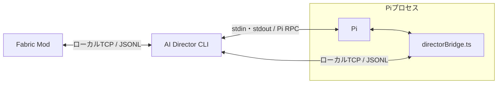

# 構成と責務

CLIはTypeScript / Node.js、ModはJava / Fabricを想定する。
Pi拡張の`directorBridge.ts`はCLI側に同梱し、Piから明示的に読み込む。

| 要素 | 責務 |
| --- | --- |
| Fabric Mod | 状態取得、イベント検出、チャット入力通知、AI発言の表示、レシピ・生データの取得 |
| CLI | 接続管理、観測記憶・イベント履歴の保存、ポーリング、hook登録・照合、Piの起動と実行調整 |
| Pi | 会話と目標の保持、推論、Toolの選択・呼び出し |
| Pi拡張 | ゲーム用Toolの登録、CLIへの要求と結果の受け渡し、最新コンテキストの注入 |

ワールドに入ったときに対応するPiセッションを開始・再開し、退出時に終了する。
CLI自体はゲーム未接続でも待機できる。
会話、観測記憶、hookはワールドとプレイヤーを識別して管理する。

Piの通常のコーディング用Toolや無関係な拡張・コンテキストの自動読み込みを無効にし、専用のシステムプロンプトとゲーム用Toolを使う。
ゲーム情報へのアクセス方針と、OS上のファイル・コマンドへアクセスするToolの設定は分けて扱う。

## 一次資料

- [Pi CLI仕様](https://github.com/earendil-works/pi/blob/main/packages/coding-agent/docs/cli.md)
- [Pi RPC仕様](https://github.com/earendil-works/pi/blob/main/packages/coding-agent/docs/rpc.md)
- [Pi拡張仕様](https://github.com/earendil-works/pi/blob/main/packages/coding-agent/docs/extensions.md)

## 関連資料

- [コンセプトと基本方針](concept.md)
- [通信プロトコル](protocol.md)
- [Tool一覧と呼び出し](tools.md)
