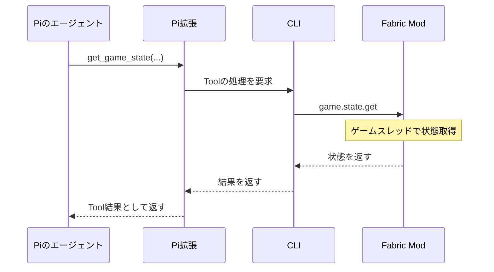

# Tool一覧と呼び出し

以下は接続実装時のTool案で、実装済み一覧ではない。[現在の実装状況](<development.md>)を参照。
LLMへ公開するToolはPi拡張で登録する。
CLIがPiのTool実行イベントを見て後から結果を注入する方式にはせず、拡張の`execute()`が実処理を待ち、その結果をPiへ返す。

| Tool案 | 引数の概要 | 実処理 |
| --- | --- | --- |
| `send_message` | `text` | Modへ表示を要求し、表示完了を待つ |
| `add_response_hook` | `event`, `filter?`, `instruction` | CLIで登録・保存し、hook IDを返す |
| `remove_response_hook` | `id` | CLIで削除 |
| `list_response_hooks` | `after?`, `limit?` | CLIの登録内容をページングして返す |
| `list_event_types` | なし | 接続Modが収集するイベント、確度、schema、filterフィールドを返す |
| `get_recent_events` | `event?`, `filter?`, `since?`, `after?`, `through?`, `limit?` | CLIのイベント履歴を検索 |
| `get_game_state` | `query` | Modから必要な生データを取得 |

`get_game_state`の対象には、所持数、周辺、ブロック、エンティティ、Mod環境などを想定する。
最初に公開するqueryの形式は、対象バージョンで取得できるデータを調べて確定する。
必要資材の計算と、現在の所持数との比較はLLMが行う。
レシピ専用Toolは作らず、静的なゲームファイルの参照と、実行中の状態・イベント検索を分ける。
OS上の読取Toolの具体的な権限は未確定であり、暗黙に有効にはしない。

hookと履歴検索のfilterは、公開されたpayload直下のscalarに対する型付き完全一致のAND条件。
条件のないイベント保存を基本とし、hookを削除しても履歴は消さない。
履歴の欠損とページングの意味は[保存・検索の契約](<development.md#保存検索の契約>)を参照。

hook一覧のbridge側実装は`director.hooks.list`の`query`で`after?`と`limit?`を受け、
`hooks`と、続きがあれば`nextCursor`を返す。`limit`は1〜8、既定値8。
IDの辞書順で読み、登録順ではない。`nextCursor`を次の`after`へ渡す。
cursorのhookを削除しても続きを読めるが、変更中の一覧はsnapshotではない。
16,000文字までの指示を含む大量hookでも、1フレームへ全件を詰め込まない。
PiのTool登録と、このbridge呼出しへの変換はまだ未実装。

`send_message`を呼んだ場合にだけプレイヤーへ発言を表示する。
内部で状態確認やhook変更をしただけなら、無言で終了できる。
ワールド識別などの接続情報はLLMの引数に要求せず、実行に結び付けた値を通信層が付ける。

要求IDは接続ごとに管理し、CLIはPi拡張からの要求とModへ転送した要求の対応を保持する。
hook管理やイベント履歴検索ではModへの転送は発生しない。
Piの完了を待っている間もCLIは通信を処理し、Toolからの要求を受け付ける。

Modは通信スレッドからゲームオブジェクトを直接操作しない。
状態取得はサーバースレッド、チャット表示はクライアントスレッドへ処理を渡し、通信でゲーム進行をブロックしない。

## 一次資料

- [Pi拡張仕様](https://github.com/earendil-works/pi/blob/main/packages/coding-agent/docs/extensions.md)

## 関連資料

- [コンテキストと記憶](context.md)
- [通信プロトコル](protocol.md)
- [ポーリングと応答hook](scheduling.md)
