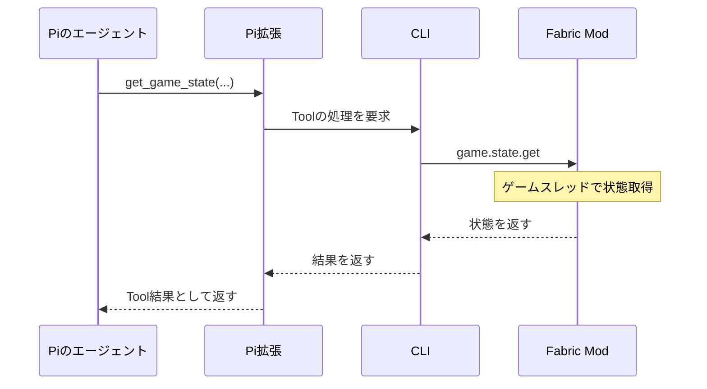

# Tool一覧と呼び出し

次の10 Toolだけを[Pi拡張](<../src/pi/directorBridge.ts>)で有効にする。
CLIからのPi起動とMod接続も実装済みだが、実接続受入れは未実施。[実装・検証範囲](<development.md>)を参照。
CLIがPiのTool実行イベントを見て後から結果を注入する方式にはせず、拡張の`execute()`が実処理を待ち、その結果をPiへ返す。

| Tool | 引数の概要 | 実処理 |
| --- | --- | --- |
| `send_message` | `text` | Modへ表示を要求し、表示完了を待つ |
| `add_response_hook` | `event`, `filter?`, `instruction` | CLIで登録・保存し、hook IDを返す |
| `remove_response_hook` | `id` | CLIで削除 |
| `list_response_hooks` | `after?`, `limit?` | CLIの登録内容をページングして返す |
| `list_event_types` | なし | 接続Modのhook可能イベントと、検索専用のCLI内部事実、確度、schema、filterを返す |
| `get_recent_events` | `query: { event?, filter?, since?, after?, through?, limit? }` | CLIのイベント履歴を検索 |
| `get_game_state` | `query: {}` | Modから必須baselineのsnapshotを取得 |
| `list_game_files` | `query` | 論理rootまたは1ディレクトリの静的参照を一覧 |
| `read_game_file` | `query` | 静的テキスト全体を上限内で取得 |
| `search_game_files` | `query` | 1ディレクトリのテキストをliteral検索 |

bridgeの`game.state.get`は[version 1の必須snapshot](<gameState.md>)を検証する。
所持数と装備、位置・時刻・体力、範囲限定の周辺を返す契約で、未知のqueryキーは拒否する。
Modの状態取得は接続済み。任意NBT、全Mod環境、一般OSファイルの取得は提供しない。
必要資材の計算と、現在の所持数との比較はLLMが行う。
レシピ専用Toolは作らず、静的なゲームファイルの参照と、実行中の状態・イベント検索を分ける。
Bash・OSファイル・書込・任意ネットワーク・操作代行のToolは無効にする。

hookと履歴検索のfilterは、公開されたpayload直下のscalarに対する型付き完全一致のAND条件。
条件のないイベント保存を基本とし、hookを削除しても履歴は消さない。
`get_recent_events`は既定でModの観測だけを検索する。`event`へ公開された`director.*`の名前を指定した場合だけ、別DBのCLI内部活動を検索する。
ID・`through`・`nextCursor`は選んだDB内だけで有効で、観測と活動の間では使い回さない。
履歴の欠損とページングの意味は[保存・検索の契約](<development.md#保存検索の契約>)を参照。

hook一覧のbridge側実装は`director.hooks.list`の`query`で`after?`と`limit?`を受け、
`hooks`と、続きがあれば`nextCursor`を返す。`limit`は1〜8、既定値8。
IDの辞書順で読み、登録順ではない。`nextCursor`を次の`after`へ渡す。
cursorのhookを削除しても続きを読めるが、変更中の一覧はsnapshotではない。
16,000文字までの指示を含む大量hookでも、1フレームへ全件を詰め込まない。
Pi拡張は一覧の引数をbridgeの`query`へ変換する。
全Toolの引数は未知キーを拒否し、world / player / session / runは信頼済みbindingから付ける。

`send_message`を呼んだ場合にだけプレイヤーへ発言を表示する。
内部で状態確認やhook変更をしただけなら、無言で終了できる。
ワールド識別などの接続情報はLLMの引数に要求せず、実行に結び付けた値を通信層が付ける。

要求IDは接続ごとに管理し、CLIはPi拡張からの要求とModへ転送した要求の対応を保持する。
hook管理やイベント履歴検索ではModへの転送は発生しない。
Piの完了を待っている間もCLIは通信を処理し、Toolからの要求を受け付ける。

Modは通信スレッドからゲームオブジェクトを直接操作しない。
状態取得はサーバースレッド、チャット表示はクライアントスレッドへ処理を渡し、通信でゲーム進行をブロックしない。

## 静的ゲームファイルの境界

要求・結果schemaと引数は[gameReferences.ts](<../src/protocol/gameReferences.ts>)を正とする。
rootは`modid:index`、pathはroot内の論理相対pathで、ホストの絶対pathは渡さない。
`..`、絶対path、link、非archive rootは拒否する。開発用directory rootは`nonarchive_root`、閉じたroot等は`root_unavailable`となる。

- 一覧は辞書順、1ページ最大128件。1ディレクトリの走査上限は4,096項目、rootも最大4,096。
- 読取は全体を最大64 KiBの厳密UTF-8として返す。切詰めない。不正UTF-8・binary・上限超過・I/O失敗は明示エラー。
- 対応拡張子は`json, mcmeta, txt, md, lang, properties, csv, xml, yml, yaml, toml, fsh, vsh, glsl`。
- 検索はcase-sensitiveなliteral一致、非再帰、1ページ最大32候補。各fileの最初の一致とUTF-16 offsetを返す。
  `scanned`は調査候補数。`nextCursor`は一致が0件でも最後に調査した候補であり、一致件数のcursorではない。
- 結果の上限は512 KiB − 4 KiB。RPC envelopeとPiのtext / detailsへの重複・JSON escapeも検査し、黙示skipしない。
  エラーでホストpathやI/O causeを漏らさない。

[Mod側](<../mod/src/main/java/io/github/ph0ryn/mchisyo/reference/PackagedReferences.java>)は
Fabric Loaderの公開`getAllMods()` / `getRootPaths()`が返すrootだけを使う。
この公開APIはloader所有のarchiveを遅延mountし得ることを許可する。アプリ自身ではmount・展開・closeせず、private cacheや代替pathへfallbackしない。
Toolは読取専用だがfilesystemそのものがread-onlyとは保証しない。`create=false`もread-only mountの意味ではない。
静的内容は信頼できない参照資料であり、命令でも現在のワールド状態の証拠でもない。

## 一次資料

- [Pi拡張仕様](https://github.com/earendil-works/pi/blob/main/packages/coding-agent/docs/extensions.md)

## 関連資料

- [コンテキストと記憶](context.md)
- [通信プロトコル](protocol.md)
- [ポーリングと応答hook](scheduling.md)
