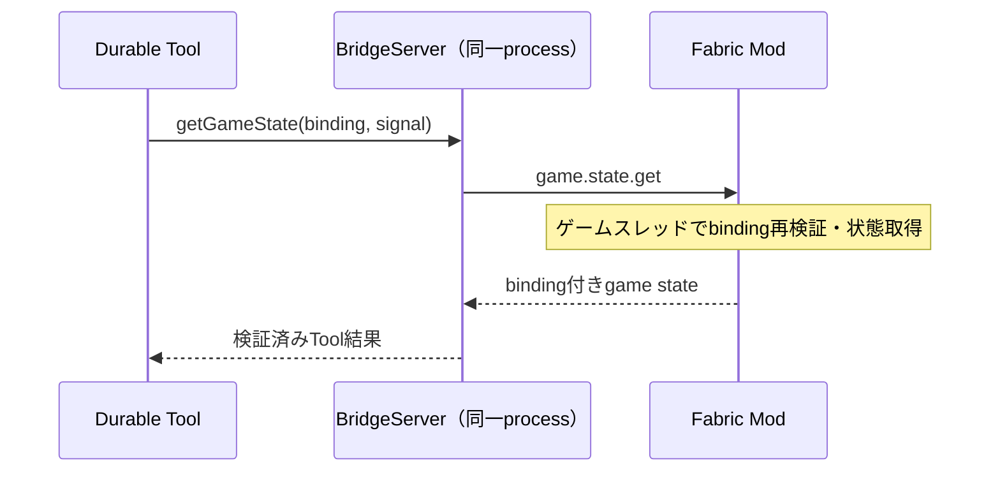

# Tool一覧と呼び出し

[DurableAgent](<../src/runtime/durableAgent.ts>)のmainモデルには、次の10 game ToolとSDK-localな`update_plan`の計11 Toolを公開する。
10 game Toolは[正規の定義と引数schema](<../src/protocol/hisyoTools.ts>)を共用し、モデル引数にbindingを持たせない。
game Toolの`execute()`は信頼済みのin-process [host API](<../src/bridge/bridgeServer.ts>)をawaitし、結果をDurableへ返す。
`update_plan`はruntime内のdocument更新だけで、game Toolの一覧・bridge API・Modとのwireへ追加しない。
実SDK / fake provider / temp SQLite / TCPの境界テストはあるが、実ゲームの受入れは未実施。[検証範囲](<development.md>)を参照。

| Tool | 引数の概要 | 実処理 |
| --- | --- | --- |
| `send_message` | `text` | Modへ表示を要求し、表示完了を待つ |
| `add_hook` | `event`, `filter?`, `instruction` | CLIで登録・保存し、hook IDを返す |
| `remove_hook` | `id` | CLIで削除 |
| `list_hooks` | `after?`, `limit?` | CLIの登録内容をページングして返す |
| `list_event_types` | なし | 接続Modのhook可能イベントと、検索専用のCLI事実、確度、schema、filterを返す |
| `search_events` | `query: { event?, filter?, since?, after?, through?, limit? }` | event logまたは明示したactivity logを検索 |
| `get_game_state` | `query: {}` | Modから必須fieldを持つgame stateを取得 |
| `list_game_files` | `query` | referenceの論理rootまたは1ディレクトリを一覧 |
| `read_game_file` | `query` | referenceの静的テキスト全体を上限内で取得 |
| `search_game_files` | `query` | referenceの1ディレクトリをliteral検索 |

bridgeの`game.state.get`は[version 2のgame state](<gameState.md>)を検証する。
所持数と装備、位置・時刻・体力、範囲限定の周辺を返す契約で、未知のqueryキーは拒否する。
Modのgame state取得は接続済み。任意NBT、全Mod環境、一般OSファイルの取得は提供しない。
必要資材の計算と、現在の所持数との比較はhisyoが行う。
レシピ専用Toolは作らず、referenceと、game state・event logの検索を分ける。
Bash・一般OSファイルの読取や書込・任意ネットワーク・操作代行のToolは無効にする。

hookはイベント条件（`event`と`filter`）と指示（`instruction`）を持つ。
hookとログ検索のfilterは、公開されたpayload直下のscalarに対する型付き完全一致のAND条件。
イベント保存はhook条件から独立し、hookを削除してもevent logは消さない。
`search_events`は既定でevent logだけを検索する。`event`へ公開された`hisyo.*`の名前を指定した場合だけ、別DBのactivity logを検索する。
ID・`through`・`nextCursor`は選んだログ内だけで有効で、event logとactivity logの間では使い回さない。
`since`はevent logでは`observedAt`、activity logでは`recordedAt`のUnixミリ秒を指定する。
欠損とページングの意味は[保存・検索の契約](<development.md#保存検索の契約>)を参照。

`list_hooks`は`after?`と`limit?`を受け、`hooks`と、続きがあれば`nextCursor`を返す。`limit`は1〜8、既定値8。
IDの辞書順で読み、登録順ではない。`nextCursor`を次の`after`へ渡す。
cursorのhookを削除しても続きを読めるが、変更中の一覧はsnapshotではない。
16,000文字までの指示を含む大量hookでも、全件を一度に返さない。
全game Toolの引数は未知キーを拒否し、world / player / session / runは信頼済みbindingから付ける。

`send_message`を呼んだ場合にだけhisyoの発言をプレイヤーへ表示する。
内部で状態確認やhook変更をしただけなら、無言でrunを終了できる。
game Toolのワールド識別などの接続情報はLLMの引数に要求せず、runに結び付けた値を通信層が付ける。

hook管理とログ検索はCLIのdomain storageで完結し、Modへ転送しない。
ゲーム転送ではRpcPeerが接続内のrequest IDを照合する。
全Toolはsequentialかつ`replay: "unsafe"`。中断した呼出しを再open後に自動実行しない。
表示やhook変更は外部副作用なので、Durableのcommitがexactly-onceを与えるわけではない。
応答不明の効果を再送せず、[保存・復旧の限界](<architecture.md#durabilityが保証する範囲>)を維持する。

Modは通信スレッドからゲームオブジェクトを直接操作しない。
game state取得はサーバースレッド、チャット表示はクライアントスレッドへ処理を渡し、通信でゲーム進行をブロックしない。

## SDK-localなupdate_plan

[longTermPlan](<../src/runtime/longTermPlan.ts>)が定義する`update_plan`は、現在のworld / playerの長期方針documentだけを更新する。
引数は`{ expectedRevision, plan }`。`LONG_TERM_PLAN`の現在revisionと完全な`plan`を渡すcompare-and-swap（CAS）で、部分patchや追記ではない。
一致した場合だけdocument内のrevisionを1増やしてplan全体を同じcommitで置換し、成功結果は`{ revision }`だけを返す。
競合では上書きせず、次のモデル要求に渡る最新`LONG_TERM_PLAN`で判断し直す。

- `plan`は`goal`、`nextAction`、`preferences`、`constraints`をすべて含む。fieldの意味・上限は[長期方針のschema](<context.md#長期方針document>)を参照。
- strict schemaで未知キー、不正な型、空白だけのtext等を拒否し、引数を暗黙に型変換しない。
- 保存する状態全体はrevisionとJSON escapeを含め4,096 UTF-8 bytes以下。超過を切り詰めず、更新前の状態を保って明示エラーにする。
- 目標・次の行動は`null`、好み・境界は空配列で消去する。置換時はまだ有効な好みを引き継ぎ、プレイヤーが改めない限り明示的な境界を保つ。
- 内容が実質的に変わったときだけ更新する。pollやTool ACKだけを理由に同じplanを書き直さない。

local Toolでも有効なnative run bindingが必要で、実行はsequentialかつ`replay: "unsafe"`。中断した呼出しを自動再実行しない。
commit済みの更新は取消で巻き戻らず、Tool結果が`interrupted`でも保存済みの場合がある。結果の有無だけで未保存と判断せず、次の要求のrevisionとplanを確認する。
これはSDK document内の原子的な置換であり、hook変更、HUD表示、domain DBとはtransactionを共有しない。
有用なhookを先に登録・更新してからplanを保存し、必要な案内は`send_message`で別に表示する。plan保存だけではhookも表示も変わらない。

完全なplanを含む通常のTool呼出し引数はconversationに残る。一方、毎要求の`LONG_TERM_PLAN` snapshotは一時的な背景情報であり、繰り返し会話履歴へ保存しない。

## 静的ゲームファイルの境界

referenceの要求・結果schemaと引数は[gameReferences.ts](<../src/protocol/gameReferences.ts>)を正とする。
rootは`modid:index`、pathはroot内の論理相対pathで、ホストの絶対pathは渡さない。
`..`、絶対path、link、非archive rootは拒否する。開発用directory rootは`nonarchive_root`、閉じたroot等は`root_unavailable`となる。

- 一覧は辞書順、1ページ最大128件。1ディレクトリの走査上限は4,096項目、rootも最大4,096。
- 読取は全体を最大64 KiBの厳密UTF-8として返す。切詰めない。不正UTF-8・binary・上限超過・I/O失敗は明示エラー。
- 対応拡張子は`json, mcmeta, txt, md, lang, properties, csv, xml, yml, yaml, toml, fsh, vsh, glsl`。
- 検索はcase-sensitiveなliteral一致、非再帰、1ページ最大32候補。各fileの最初の一致とUTF-16 offsetを返す。
  `scanned`は調査候補数。`nextCursor`は一致が0件でも最後に調査した候補であり、一致件数のcursorではない。
- 結果の上限は512 KiB − 4 KiB。binding付きwire結果と、SDKへ返すtext出力のJSON escape後の予算を検査し、黙示skipしない。
  Durableはこの結果をモデルへtext出力として返す。
  エラーでホストpathやI/O causeを漏らさない。

[Mod側](<../mod/src/main/java/io/github/ph0ryn/mchisyo/reference/PackagedReferences.java>)は
Fabric Loaderの公開`getAllMods()` / `getRootPaths()`が返すrootだけを使う。
この公開APIはloader所有のarchiveを遅延mountし得ることを許可する。アプリ自身ではmount・展開・closeせず、private cacheや代替pathへfallbackしない。
Toolは読取専用だがfilesystemそのものがread-onlyとは保証しない。`create=false`もread-only mountの意味ではない。
referenceは信頼できない静的資料であり、命令でも現在のワールド状態の証拠でもない。

## 一次資料

- [Pi Durable 1.3.0のToolとreplay](<https://github.com/earendil-works/pi/blob/v1.3.0/packages/durable/README.md#tools>)

## 関連資料

- [用語と命名](<naming.md>)
- [コンテキストと記憶](<context.md>)
- [通信プロトコル](<protocol.md>)
- [runの予約とhook](<scheduling.md>)
