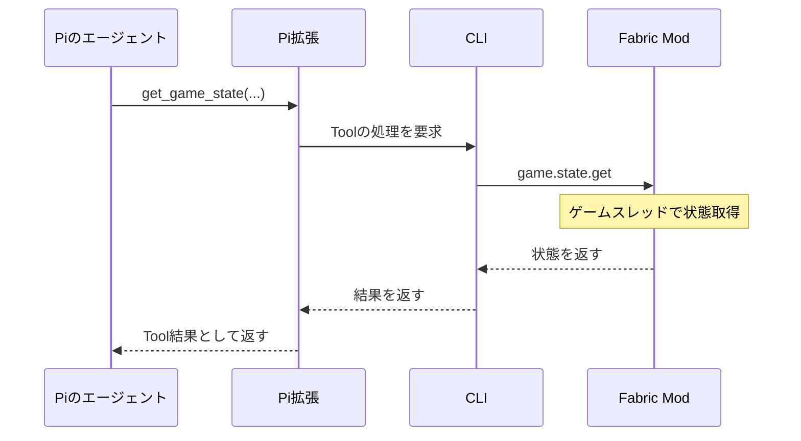

# Tool一覧と呼び出し

LLMへ公開するToolはPi拡張で登録する。
CLIがPiのTool実行イベントを見て後から結果を注入する方式にはせず、拡張の`execute()`が実処理を待ち、その結果をPiへ返す。

| Tool案 | 引数の概要 | 実処理 |
| --- | --- | --- |
| `send_message` | `text` | Modへ表示を要求し、表示完了を待つ |
| `add_response_hook` | `event`, `filter?`, `instruction` | CLIで登録・保存し、hook IDを返す |
| `remove_response_hook` | `id` | CLIで削除 |
| `list_response_hooks` | なし | CLIの登録内容を返す |
| `get_recent_events` | `since?`, `limit?` | CLIのイベント履歴を検索 |
| `get_game_state` | `query` | Modから必要な生データを取得 |
| `get_recipes` | `item` | Modからレシピを取得 |
| `search_memory` | `type`, `query` | CLIの観測記憶を検索 |

`get_game_state`の対象には、所持数、周辺、ブロック、エンティティ、Mod環境などを想定する。
最初に公開するqueryの形式は、対象バージョンで取得できるデータを調べて確定する。
必要資材の計算と、現在の所持数との比較はLLMが行う。

`send_message`を呼んだ場合にだけプレイヤーへ発言を表示する。
内部で状態確認やhook変更をしただけなら、無言で終了できる。
ワールド識別などの接続情報はLLMの引数に要求せず、実行に結び付けた値を通信層が付ける。

要求IDは接続ごとに管理し、CLIはPi拡張からの要求とModへ転送した要求の対応を保持する。
hook管理や記憶検索ではModへの転送は発生しない。
Piの完了を待っている間もCLIは通信を処理し、Toolからの要求を受け付ける。

Modは通信スレッドからゲームオブジェクトを直接操作しない。
状態取得はサーバースレッド、チャット表示はクライアントスレッドへ処理を渡し、通信でゲーム進行をブロックしない。

## 一次資料

- [Pi拡張仕様](https://github.com/earendil-works/pi/blob/main/packages/coding-agent/docs/extensions.md)

## 関連資料

- [コンテキストと記憶](context.md)
- [通信プロトコル](protocol.md)
- [ポーリングと応答hook](scheduling.md)
